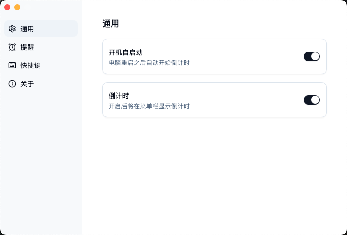
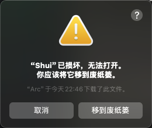

# Shui - Water Reminder Assistant

<p align="center">
  
  <br/>
</p>

A cross-platform desktop app focused on water intake reminders, promoting office workers' health 💪 and improving your drinking habits.

## ✨ Key Features

- 🎯 Daily Water Intake Goals
- 🖥️ Full-screen Reminders - Elegant and Unmissable Break Notifications
- ⏰ Smart Time Management
  - Customizable Reminder Intervals
  - Smart Workday Reminders
  - Custom Time Range
- 🔔 Diverse Notification Methods
  - Full-screen Notification Page
  - Native System Notifications
  - Tray Real-time Countdown
  - Goal Completion Sound Effects
- 💡 Smart and User-friendly
  - Silent autostart: count down in the background after login and open settings from the tray ([details](docs/silent-autostart.md))
  - Automatic Workday Recognition
  - Auto-pause on Screen Lock/Sleep
  - Tray Quick Actions
  - App Whitelist (Default: Tencent Meeting, Zoom, Google Meet, Microsoft Teams)
- 📝 Drink History ([details](docs/drink-records.md))
  - Manually record 50/100/200/300 ml, including when native notifications are enabled
  - View daily totals and individual entries for the last 7 or 30 days
  - Confirm before undoing new entries; multi-monitor actions and retries do not duplicate drinks
- 🎨 Appearance Themes ([details](docs/themes.md))
  - Light, dark and system appearance, with persisted selection and same-origin window sync
- 📊 Hydration Statistics and Analysis ([details](docs/hydration-statistics.md))
  - 7/30-day intake trends, daily averages and goal-completion days
  - Drinking-time distribution and intervals between entries on the same day
  - Full-screen reminder counts, outcomes and display duration
  - CSV export of daily totals and individual entries across all dates
- 💾 Drink History Backup and Import ([details](docs/data-backup.md))
  - JSON backups preserve daily totals, historical goals, individual entries and revoked request IDs
  - Preview before importing; confirmation only adds missing dates without overwriting existing days
  - Repeated imports do not accumulate totals; failed saves can be retried

## 🖥 Application Interface

<p align="center">
  
  <br/>
  
</p>

## 🚀 Getting Started

### Platform Support

- ✅ macOS
- ✅ Windows
- ✅ Linux
- 🚧 Android (coming soon)

### Download and Installation

Download the latest version from the [Releases](https://github.com/rock-zhang/Shui/releases/) page.

#### macOS

- Apple Silicon: Download `Shui_x.x.x_aarch64.dmg`
- Intel Chip: Download `Shui_x.x.x_x64.dmg`

#### Windows

- 64-bit System: Download `Shui_x.x.x_x64-setup.exe`
- 32-bit System: Download `Shui_x.x.x_x86-setup.exe`
- ARM64 Architecture: Download `Shui_x.x.x_arm64-setup.exe`

#### Note



If you encounter the "Shui is damaged and can't be opened" message on `macOS`, please run the following command in Terminal:

```shell
sudo xattr -r -d com.apple.quarantine /Applications/Shui.app
```

## 📱 Android vs Desktop

The Android build ships as a standalone app, so the UI no longer carries desktop-comparison notes. The mapping and trade-offs are kept here for maintainers.

| Desktop | Android |
| --- | --- |
| Tray countdown | Today → "Reminder rhythm" card |
| Global hotkeys | "Log a drink" action on system notifications |
| Silent autostart | Alarms rebuilt after the boot broadcast |
| App whitelist / lock-screen auto-pause | Quiet hours + manual pause |
| In-app auto update | Play Store updates (in-app self-updates violate store policy) |
| Installed-app list | Not collected (sensitive permission) |

Unchanged: daily goal, reminder interval (minutes), repeat days, time range, full-screen reminders / system notifications / sound, drink logging and undo, trend and habit statistics, CSV export, JSON backup and import, appearance themes.

Background delivery depends on system alarms, notification permission and the battery-optimization whitelist; some vendor ROMs also require autostart / background-lock permission. See `src-tauri/gen/android/` for the native implementation.

**System bars**: the status bar and gesture navigation bar share the page background, with icon contrast inverted per theme. Colours come from the `background` token in `src/app/globals.css` (light `#ffffff` / dark `#020618`) and are declared in `res/values/colors.xml`. `values/themes.xml` and `values-night/themes.xml` cover the cold-start frame; at runtime the `set_system_bar_theme` command follows the resolved next-themes theme, which the user can set independently of the OS. `tests/system-bars.test.cjs` asserts that the CSS, Android colours and `themeColor` stay in sync.

## 🛣 Development Roadmap

### Implemented Features

- [x] Basic Reminder Functionality
- [x] Customizable Reminder Intervals
- [x] Smart Workday Reminders
- [x] System Tray Support
- [x] Global Hotkeys
- [x] App Whitelist Management
- [x] Auto-pause on Screen Lock/Sleep
- [x] Tray Quick Actions
- [x] Custom Time Range
- [x] Native System Notifications
- [x] Tray Real-time Countdown
- [x] Manual Drink Recording (50/100/200/300 ml)
- [x] Drink History Details (Last 7 or 30 Days)
- [x] Safe Drink Undo and Request Deduplication

### Development Plans

- [x] Windows Support
- [x] Linux Support
- [x] Reminder Sound Effects
- [ ] Multi-language Support
- [x] Data Statistics and Analysis
  - [x] Water Intake Trend Charts (Last 7 or 30 Days)
  - [x] Break Reminder Statistics (Counts and Display Duration)
  - [x] Drink History Export (CSV)
  - [x] Water Intake Time Distribution
  - [x] Water Intake Interval Analysis
- [x] Appearance Theme Switching (Light, Dark and System)
- [x] Drink History Backup and Import (JSON; see [details](docs/data-backup.md))

Reminder display duration is not actual rest time. CSV is for viewing and analysis; JSON preserves drink entries, historical goals and undo metadata for backup and import. Imports only add missing dates; CSV import is not supported.

## 🛠 Tech Stack

- [Tauri](https://tauri.app/) - Cross-platform Desktop App Framework
- [Next.js](https://nextjs.org/) - React Application Framework
- [React](https://reactjs.org/) - User Interface Framework
- [Rust](https://www.rust-lang.org/) - Backend Logic Implementation
- [shadcn/ui](https://ui.shadcn.com/) - UI Component Library

## 📦 Release Process

Pushing a `v*` tag triggers the [publish workflow](.github/workflows/publish.yaml), which builds all platforms, creates a draft Release and refreshes the auto-update manifest.

**Do not create tags manually.** Version numbers live in four files and are maintained by a single command that combines bumping, committing and tagging:

```shell
# On main with a clean index
git switch main && git pull --ff-only
yarn release 0.3.0          # bumps 4 files, creates a commit and tag v0.3.0
git push origin HEAD        # push the version commit first
git push origin v0.3.0      # pushing the tag triggers the workflow
```

`package.json` is the single source of truth. `yarn release <version>` also updates `src-tauri/tauri.conf.json`, `src-tauri/Cargo.toml` and `Cargo.lock` (daily CI runs `cargo build --locked`, so the lockfile must match). It runs on `main` only, refuses a dirty index, and **never pushes**. Use `yarn version:check` to verify consistency without changing anything.

Three version gates: `ci.yaml` checks the four files on every PR, `publish.yaml` fails within seconds if the tag doesn't match (before the 7 build jobs start), and `upload-assets` re-checks before uploading. `upload-assets` now **rebuilds** `latest.json` from the Release's `.sig` and installer assets, validating signatures and all 7 main platforms, then uploads it to the `updater` Release.

Before releasing, make sure the `updater` Release exists and is published (`.../releases/download/updater/latest.json`) and `TAURI_SIGNING_PRIVATE_KEY` is configured. CI creates a **draft** Release — click **Publish release** on GitHub before clients can detect the update.

If a run fails, delete the draft Release and the tag before retrying:

```shell
gh release delete v0.3.0 --repo rock-zhang/Shui --yes
git push origin :refs/tags/v0.3.0
git tag -d v0.3.0
```

Then either push the fix and re-tag (`git push origin HEAD && git tag v0.3.0 && git push origin v0.3.0`) if the version was already bumped — `yarn release 0.3.0` will refuse with "version unchanged" — or run `yarn release 0.3.0` if the version in code is still old.

## 📱 Android Production Builds (APK / AAB)

The section above covers the desktop release pipeline. Android is packaged separately: **AAB for Google Play, APK for sideloading and third-party stores**.

`--debug` builds are for local testing only — unoptimized Rust, debug symbols kept (2–3× larger), and signed with the debug certificate, which Play rejects outright. Anything you hand out must be a release build.

### 1. One-time setup: create a release keystore

```shell
keytool -genkeypair -v \
  -keystore ~/.android-keys/shui-release.jks \
  -alias shui \
  -keyalg RSA -keysize 2048 -validity 10000 \
  -dname "CN=Shui, O=Shui, C=CN"
```

Keep `-validity` long enough to outlive the app — Google Play requires a signing certificate valid through at least 2033.

> ⚠️ **Lose this file and you can never update the published app again.** Back it up to a password manager and offline media, not just this machine.
> Strongly recommended: enable **Play App Signing** and treat this as the *upload key* — Google can reset it if it leaks or is lost.

### 2. Configure signing (pick one)

**Option A: local file** (recommended for solo development)

Create `src-tauri/gen/android/key.properties` (already in `.gitignore`):

```properties
storeFile=/Users/you/.android-keys/shui-release.jks
storePassword=your-store-password
keyAlias=shui
keyPassword=your-key-password
```

An absolute path for `storeFile` is simplest; relative paths resolve against `src-tauri/gen/android/`.

**Option B: environment variables** (CI, or when nothing may touch disk)

| Variable | Meaning |
| --- | --- |
| `ANDROID_KEYSTORE_FILE` | absolute path to the keystore |
| `ANDROID_KEYSTORE_PASSWORD` | store password |
| `ANDROID_KEY_ALIAS` | key alias |
| `ANDROID_KEY_PASSWORD` | key password |

> Release signing activates only when all four are present. **Miss any one and it silently falls back to the debug certificate** — installs fine locally, rejected by Play. Always verify the signature (step 5).

### 3. Bump the version

```shell
yarn release 0.3.0     # syncs 4 version files, commits, tags
```

Android's `versionCode` is **never written by hand**: it is derived from `version` in `tauri.conf.json` into `src-tauri/gen/android/app/tauri.properties` at build time (`major*1000000 + minor*1000 + patch`, so `0.2.32` → `2032`). That file is generated, git-ignored, and overwritten on every build. **As long as the version increases, versionCode increases** — Play's "version code must be higher than production" can't surprise you.

### 4. Build

```shell
# AAB — for Google Play
yarn tauri android build --aab -t aarch64

# APK — sideloading / third-party stores / internal testing
yarn tauri android build --apk -t aarch64
```

- **Never pass `--apk` and `--aab` in the same command**: with Tauri CLI 2.x the second Gradle invocation waits on a socket that never opens and hangs forever. Run them as two separate commands.
- `-t` selects ABIs: `aarch64` (virtually all phones, the minimum), `armv7` (older devices), `x86_64` (emulators). Multiple values are space-separated: `-t aarch64 armv7`. Omit it to build all ABIs (much larger output).
- `--ci` is optional — non-interactive, no confirmation prompts.
- No manual frontend step: release builds run `beforeBuildCommand` (`yarn build`) automatically.

Output (a single-ABI build still lands in a `universal` container):

```
src-tauri/gen/android/app/build/outputs/
├── bundle/universalRelease/app-universal-release.aab   # for Play, ~11 MB
└── apk/universal/release/app-universal-release.apk     # for distribution, ~19 MB
```

### 5. Verify the signature (every production build)

```shell
# AAB: signing block present, not a debug certificate
unzip -l src-tauri/gen/android/app/build/outputs/bundle/universalRelease/app-universal-release.aab \
  | grep -E 'META-INF/.*\.(RSA|DSA|EC|SF)'
keytool -printcert -jarfile src-tauri/gen/android/app/build/outputs/bundle/universalRelease/app-universal-release.aab | head -3

# APK
$ANDROID_HOME/build-tools/34.0.0/apksigner verify --print-certs \
  src-tauri/gen/android/app/build/outputs/apk/universal/release/app-universal-release.apk | head -3
```

If you see `CN=Android Debug`, it fell back to the debug certificate — revisit step 2.

### 6. Build in CI

[`.github/workflows/android-release.yml`](.github/workflows/android-release.yml) is triggered manually from the Actions tab; it takes artifact type (both / aab / apk) and ABI list as inputs.

Configure four secrets (mirroring step 2):

| Secret | How to produce it |
| --- | --- |
| `ANDROID_KEYSTORE_BASE64` | `base64 -i ~/.android-keys/shui-release.jks` (macOS) or `base64 -w0 shui-release.jks` (Linux) |
| `ANDROID_KEYSTORE_PASSWORD` | same store password |
| `ANDROID_KEY_ALIAS` | same key alias |
| `ANDROID_KEY_PASSWORD` | same key password |

CI decodes the keystore, verifies the AAB is not debug-signed, deletes the key file afterwards, and publishes the artifacts (kept 14 days).

### 7. Troubleshooting

| Symptom | Cause and fix |
| --- | --- |
| `next build` fails with `TypeError: Cannot read properties of undefined (reading 'length')` (`WasmHash._updateWithBuffer` in the stack) | Corrupted webpack cache. `rm -rf .next dist && mkdir -p dist` and rebuild. Note `distDir` here is `dist`, not the default `.next` |
| `beforeBuildCommand` `yarn build` fails with safe-delete / `ENOENT` | Node is wrapped by a filesystem shim (some agent/sandbox tools inject one). Prefix with `NODE_OPTIONS= yarn tauri android build ...` |
| Play rejects with "version code already used" | Version wasn't bumped, so versionCode didn't change. Run `yarn release <new-version>` |
| Play rejects with "not signed / invalid signature" | Fell back to debug signing — the four parameters in step 2 are incomplete |
| Build hangs with Gradle starting a second time | `--apk --aab` were passed together; split them |
| Package is unexpectedly large (30 MB+) | You built a debug package (`--debug`), or passed every ABI to `-t` |

## Community

<picture>
  <source media="(prefers-color-scheme: dark)" srcset="public/qrcode_wechat_dark.png" />
  <source media="(prefers-color-scheme: light)" srcset="public/qrcode_wechat_light.png" />
  
</picture>

## ☕ Support

If you find this project helpful, please give the author a free Star. Thank you for your support!

## Star History

<a href="https://www.star-history.com/#rock-zhang/Shui&Date">
 <picture>
   <source media="(prefers-color-scheme: dark)" srcset="https://api.star-history.com/svg?repos=rock-zhang/Shui&type=Date&theme=dark" />
   <source media="(prefers-color-scheme: light)" srcset="https://api.star-history.com/svg?repos=rock-zhang/Shui&type=Date" />
   
 </picture>
</a>
