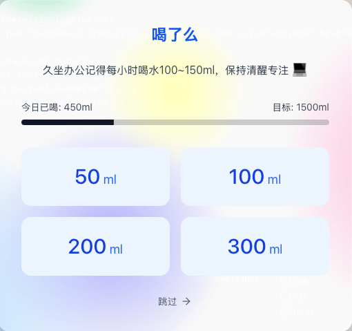
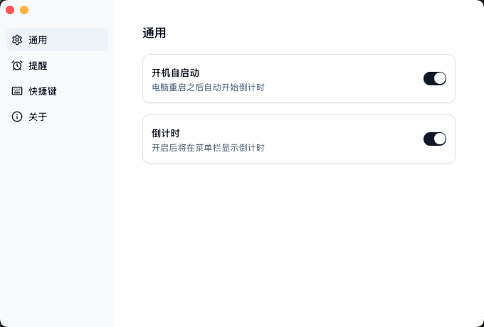
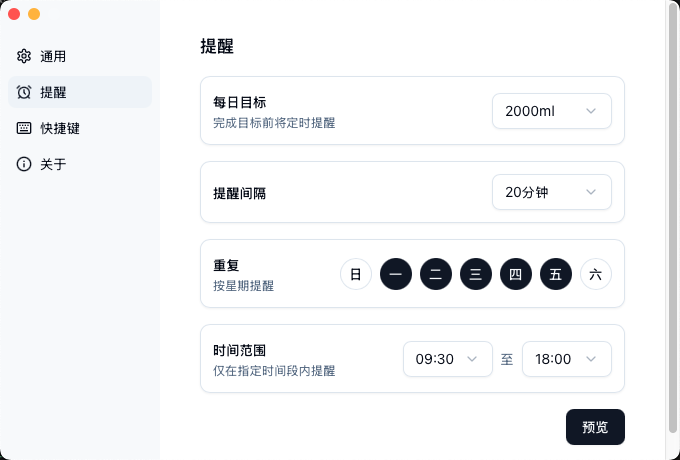
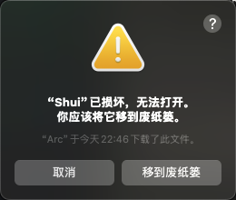

# Shui - Water Reminder Assistant

<p align="center">
  
  <br/>
</p>

A cross-platform desktop app focused on water intake reminders, promoting office workers' health 💪 and improving your drinking habits.

## ✨ Key Features

- 🎯 Daily Water Intake Goals
- 🖥️ Full-screen Reminders - Elegant and Unmissable Break Notifications
- ⏰ Smart Time Management
  - Customizable Reminder Intervals
  - Smart Workday Reminders
  - Custom Time Range
- 🔔 Diverse Notification Methods
  - Full-screen Notification Page
  - Native System Notifications
  - Tray Real-time Countdown
  - Goal Completion Sound Effects
- 💡 Smart and User-friendly
  - Automatic Workday Recognition
  - Auto-pause on Screen Lock/Sleep
  - Tray Quick Actions
  - App Whitelist (Default: Tencent Meeting, Zoom, Google Meet, Microsoft Teams)
- 📝 Drink History ([details](docs/drink-records.md))
  - Manually record 50/100/200/300 ml, including when native notifications are enabled
  - View daily totals and individual entries for the last 7 or 30 days
  - Confirm before undoing new entries; multi-monitor actions and retries do not duplicate drinks
- 🎨 Appearance Themes ([details](docs/themes.md))
  - Light, dark and system appearance, with persisted selection and same-origin window sync
- 📊 Hydration Statistics and Analysis ([details](docs/hydration-statistics.md))
  - 7/30-day intake trends, daily averages and goal-completion days
  - Drinking-time distribution and intervals between entries on the same day
  - Full-screen reminder counts, outcomes and display duration
  - CSV export of daily totals and individual entries across all dates

## 🖥 Application Interface

<p align="center">
  
  <br/>
  
</p>

## 🚀 Getting Started

### Platform Support

- ✅ macOS
- ✅ Windows
- 🚧 Linux (coming soon)
- 🚧 Android (coming soon)

### Download and Installation

Download the latest version from the [Releases](https://github.com/rock-zhang/Shui/releases/) page.

#### macOS

- Apple Silicon: Download `Shui_x.x.x_aarch64.dmg`
- Intel Chip: Download `Shui_x.x.x_x64.dmg`

#### Windows

- 64-bit System: Download `Shui_x.x.x_x64-setup.exe`
- 32-bit System: Download `Shui_x.x.x_x86-setup.exe`
- ARM64 Architecture: Download `Shui_x.x.x_arm64-setup.exe`

#### Note



If you encounter the "Shui is damaged and can't be opened" message on `macOS`, please run the following command in Terminal:

```shell
sudo xattr -r -d com.apple.quarantine /Applications/Shui.app
```

## 🛣 Development Roadmap

### Implemented Features

- [x] Basic Reminder Functionality
- [x] Customizable Reminder Intervals
- [x] Smart Workday Reminders
- [x] System Tray Support
- [x] Global Hotkeys
- [x] App Whitelist Management
- [x] Auto-pause on Screen Lock/Sleep
- [x] Tray Quick Actions
- [x] Custom Time Range
- [x] Native System Notifications
- [x] Tray Real-time Countdown
- [x] Manual Drink Recording (50/100/200/300 ml)
- [x] Drink History Details (Last 7 or 30 Days)
- [x] Safe Drink Undo and Request Deduplication

### Development Plans

- [x] Windows Support
- [x] Linux Support
- [x] Reminder Sound Effects
- [ ] Multi-language Support
- [x] Data Statistics and Analysis
  - [x] Water Intake Trend Charts (Last 7 or 30 Days)
  - [x] Break Reminder Statistics (Counts and Display Duration)
  - [x] Drink History Export (CSV)
  - [x] Water Intake Time Distribution
  - [x] Water Intake Interval Analysis
- [x] Appearance Theme Switching (Light, Dark and System)
- [ ] Drink History Backup and Import (JSON)

Reminder display duration is not actual rest time. CSV is intended for viewing and analysis, not complete backups. JSON backup and import are not included in this branch.

## 🛠 Tech Stack

- [Tauri](https://tauri.app/) - Cross-platform Desktop App Framework
- [Next.js](https://nextjs.org/) - React Application Framework
- [React](https://reactjs.org/) - User Interface Framework
- [Rust](https://www.rust-lang.org/) - Backend Logic Implementation
- [shadcn/ui](https://ui.shadcn.com/) - UI Component Library

## Community

<picture>
  <source media="(prefers-color-scheme: dark)" srcset="public/qrcode_wechat_dark.png" />
  <source media="(prefers-color-scheme: light)" srcset="public/qrcode_wechat_light.png" />
  
</picture>

## ☕ Support

If you find this project helpful, please give the author a free Star. Thank you for your support!

## Star History

<a href="https://www.star-history.com/#rock-zhang/Shui&Date">
 <picture>
   <source media="(prefers-color-scheme: dark)" srcset="https://api.star-history.com/svg?repos=rock-zhang/Shui&type=Date&theme=dark" />
   <source media="(prefers-color-scheme: light)" srcset="https://api.star-history.com/svg?repos=rock-zhang/Shui&type=Date" />
   
 </picture>
</a>
