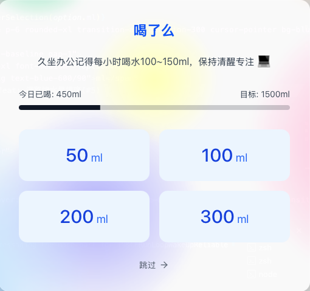
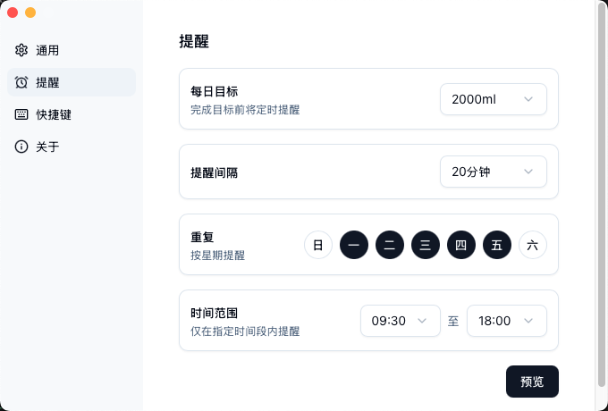

# Shui - Water Reminder Assistant

<p align="center">
  
  <br/>
</p>

A cross-platform desktop app focused on water intake reminders, promoting office workers' health 💪 and improving your drinking habits.

## ✨ Key Features

- 🎯 Daily Water Intake Goals
- 🖥️ Full-screen Reminders - Elegant and Unmissable Break Notifications
- ⏰ Smart Time Management
  - Customizable Reminder Intervals
  - Smart Workday Reminders
  - Custom Time Range
- 🔔 Diverse Notification Methods
  - Full-screen Notification Page
  - Native System Notifications
  - Tray Real-time Countdown
  - Goal Completion Sound Effects
- 💡 Smart and User-friendly
  - Silent autostart: count down in the background after login and open settings from the tray ([details](docs/silent-autostart.md))
  - Automatic Workday Recognition
  - Auto-pause on Screen Lock/Sleep
  - Tray Quick Actions
  - App Whitelist (Default: Tencent Meeting, Zoom, Google Meet, Microsoft Teams)
- 📝 Drink History ([details](docs/drink-records.md))
  - Manually record 50/100/200/300 ml, including when native notifications are enabled
  - View daily totals and individual entries for the last 7 or 30 days
  - Confirm before undoing new entries; multi-monitor actions and retries do not duplicate drinks
- 🎨 Appearance Themes ([details](docs/themes.md))
  - Light, dark and system appearance, with persisted selection and same-origin window sync
- 📊 Hydration Statistics and Analysis ([details](docs/hydration-statistics.md))
  - 7/30-day intake trends, daily averages and goal-completion days
  - Drinking-time distribution and intervals between entries on the same day
  - Full-screen reminder counts, outcomes and display duration
  - CSV export of daily totals and individual entries across all dates
- 💾 Drink History Backup and Import ([details](docs/data-backup.md))
  - JSON backups preserve daily totals, historical goals, individual entries and revoked request IDs
  - Preview before importing; confirmation only adds missing dates without overwriting existing days
  - Repeated imports do not accumulate totals; failed saves can be retried

## 🖥 Application Interface

<p align="center">
  
  <br/>
  
</p>

## 🚀 Getting Started

### Platform Support

- ✅ macOS
- ✅ Windows
- ✅ Linux
- 🚧 Android (standalone app — see [Android notes](README-ANDROID.en.md))

### Download and Installation

Download the latest version from the [Releases](https://github.com/rock-zhang/Shui/releases/) page.

#### macOS

- Apple Silicon: Download `Shui_x.x.x_aarch64.dmg`
- Intel Chip: Download `Shui_x.x.x_x64.dmg`

#### Windows

- 64-bit System: Download `Shui_x.x.x_x64-setup.exe`
- 32-bit System: Download `Shui_x.x.x_x86-setup.exe`
- ARM64 Architecture: Download `Shui_x.x.x_arm64-setup.exe`

#### Note


If you encounter the "Shui is damaged and can't be opened" message on `macOS`, please run the following command in Terminal:

```shell
sudo xattr -r -d com.apple.quarantine /Applications/Shui.app
```

## 📱 Android

The Android build ships as a standalone app. It shares the same drink data with the desktop build, while reminders, notifications, system bars and other native capabilities are reimplemented.

Feature mapping, system-bar theming, the background reminder pipeline, and the **full APK / AAB production build flow** (release keystore, signing configuration, versionCode derivation, signature verification, CI, troubleshooting) all live in **[README-ANDROID.en.md](README-ANDROID.en.md)**.

## 🛣 Development Roadmap

### Implemented Features

- [x] Basic Reminder Functionality
- [x] Customizable Reminder Intervals
- [x] Smart Workday Reminders
- [x] System Tray Support
- [x] Global Hotkeys
- [x] App Whitelist Management
- [x] Auto-pause on Screen Lock/Sleep
- [x] Tray Quick Actions
- [x] Custom Time Range
- [x] Native System Notifications
- [x] Tray Real-time Countdown
- [x] Manual Drink Recording (50/100/200/300 ml)
- [x] Drink History Details (Last 7 or 30 Days)
- [x] Safe Drink Undo and Request Deduplication

### Development Plans

- [x] Windows Support
- [x] Linux Support
- [x] Reminder Sound Effects
- [ ] Multi-language Support
- [x] Data Statistics and Analysis
  - [x] Water Intake Trend Charts (Last 7 or 30 Days)
  - [x] Break Reminder Statistics (Counts and Display Duration)
  - [x] Drink History Export (CSV)
  - [x] Water Intake Time Distribution
  - [x] Water Intake Interval Analysis
- [x] Appearance Theme Switching (Light, Dark and System)
- [x] Drink History Backup and Import (JSON; see [details](docs/data-backup.md))

Reminder display duration is not actual rest time. CSV is for viewing and analysis; JSON preserves drink entries, historical goals and undo metadata for backup and import. Imports only add missing dates; CSV import is not supported.

## 🛠 Tech Stack

- [Tauri](https://tauri.app/) - Cross-platform Desktop App Framework
- [Next.js](https://nextjs.org/) - React Application Framework
- [React](https://reactjs.org/) - User Interface Framework
- [Rust](https://www.rust-lang.org/) - Backend Logic Implementation
- [shadcn/ui](https://ui.shadcn.com/) - UI Component Library

## 📦 Release Process

Pushing a `v*` tag triggers the [publish workflow](.github/workflows/publish.yaml), which builds all platforms, creates a draft Release and refreshes the auto-update manifest.

**Do not create tags manually.** Version numbers live in four files and are maintained by a single command that combines bumping, committing and tagging:

```shell
# On main with a clean index
git switch main && git pull --ff-only
yarn release 0.3.0          # bumps 4 files, creates a commit and tag v0.3.0
git push origin HEAD        # push the version commit first
git push origin v0.3.0      # pushing the tag triggers the workflow
```

`package.json` is the single source of truth. `yarn release <version>` also updates `src-tauri/tauri.conf.json`, `src-tauri/Cargo.toml` and `Cargo.lock` (daily CI runs `cargo build --locked`, so the lockfile must match). It runs on `main` only, refuses a dirty index, and **never pushes**. Use `yarn version:check` to verify consistency without changing anything.

Three version gates: `ci.yaml` checks the four files on every PR, `publish.yaml` fails within seconds if the tag doesn't match (before the 7 build jobs start), and `upload-assets` re-checks before uploading. `upload-assets` now **rebuilds** `latest.json` from the Release's `.sig` and installer assets, validating signatures and all 7 main platforms, then uploads it to the `updater` Release.

Before releasing, make sure the `updater` Release exists and is published (`.../releases/download/updater/latest.json`) and `TAURI_SIGNING_PRIVATE_KEY` is configured. CI creates a **draft** Release — click **Publish release** on GitHub before clients can detect the update.

If a run fails, delete the draft Release and the tag before retrying:

```shell
gh release delete v0.3.0 --repo rock-zhang/Shui --yes
git push origin :refs/tags/v0.3.0
git tag -d v0.3.0
```

Then either push the fix and re-tag (`git push origin HEAD && git tag v0.3.0 && git push origin v0.3.0`) if the version was already bumped — `yarn release 0.3.0` will refuse with "version unchanged" — or run `yarn release 0.3.0` if the version in code is still old.

## 📱 Android Production Builds (APK / AAB)

Kept in a dedicated document: **[README-ANDROID.en.md](README-ANDROID.en.md)** — release keystore, both signing configurations, versionCode derivation, build commands and outputs, signature verification, CI, troubleshooting.

## Community

<picture>
  <source media="(prefers-color-scheme: dark)" srcset="public/qrcode_wechat_dark.png" />
  <source media="(prefers-color-scheme: light)" srcset="public/qrcode_wechat_light.png" />
  
</picture>

## ☕ Support

If you find this project helpful, please give the author a free Star. Thank you for your support!

## Star History

<a href="https://www.star-history.com/#rock-zhang/Shui&Date">
 <picture>
   <source media="(prefers-color-scheme: dark)" srcset="https://api.star-history.com/svg?repos=rock-zhang/Shui&type=Date&theme=dark" />
   <source media="(prefers-color-scheme: light)" srcset="https://api.star-history.com/svg?repos=rock-zhang/Shui&type=Date" />
   
 </picture>
</a>
