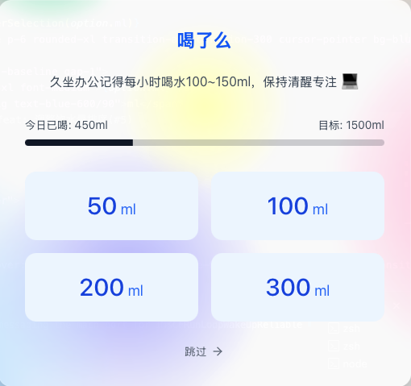
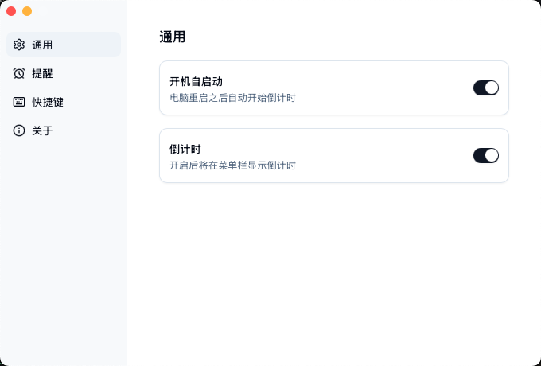
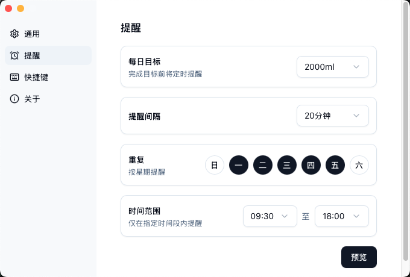
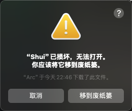

# Shui - 喝水提醒助手

<p align="center">
  
  <br/>
</p>

一个专注喝水提醒的跨端桌面 App，关注打工人健康 💪 ，改善你的喝水习惯。

## ✨ 主要特性

- 🎯 每日饮水目标设定
- 🖥️ 全屏提醒 - 优雅且不可忽视的休息提示
- ⏰ 智能时间管理
  - 自定义提醒间隔
  - 工作日智能提醒
  - 自定义时间范围
- 🔔 多样化提醒方式
  - 全屏通知页面
  - 系统原生通知
  - 托盘实时倒计时
  - 目标完成音效提醒
- 💡 智能且人性化
  - 静默开机自启：登录后后台计时，可从托盘打开设置（[使用说明](docs/silent-autostart.md)）
  - 自动识别工作日
  - 息屏、锁屏自动暂停
  - 托盘快捷操作
  - 应用白名单（默认：腾讯会议, Zoom, Google Meet, Microsoft Teams）
- 📝 饮水记录（[使用说明](docs/drink-records.md)）
  - 手动记录 50/100/200/300 ml，系统通知模式下也可补记
  - 查看近 7 天或 30 天的每日总量与逐笔明细
  - 二次确认后撤销新记录，多屏操作和失败重试不重复记水
- 🎨 外观主题（[使用说明](docs/themes.md)）
  - 浅色、深色和跟随系统，保存选择并同步同源窗口
- 📊 饮水统计与分析（[使用说明](docs/hydration-statistics.md)）
  - 近 7 天或 30 天饮水趋势、日均饮水量与达标天数
  - 饮水时间分布及同一天内的饮水间隔分析
  - 全屏提醒次数、确认/跳过/超时结果及展示时长统计
  - CSV 导出全部日期的饮水总量与逐笔明细
- 💾 饮水记录备份与导入（[使用说明](docs/data-backup.md)）
  - JSON 备份保留每日总量、历史目标、逐笔明细及撤销标识
  - 导入前预览，确认后只补充缺失日期，不覆盖已有日期
  - 重复导入不累加，保存失败可重试

## 🖥 应用界面

<p align="center">
  
  <br/>
  
</p>

## 🚀 开始使用

### Platform Support

- ✅ macOS
- ✅ Windows
- ✅ Linux
- 🚧 Android (coming soon)

### 下载安装

从 [Releases](https://github.com/rock-zhang/Shui/releases/) 页面下载最新版本。

#### macOS

- Apple Silicon：下载 `Shui_x.x.x_aarch64.dmg`
- Intel Chip：下载 `Shui_x.x.x_x64.dmg`

#### Windows

- 64 位系统：下载 `Shui_x.x.x_x64-setup.exe`
- 32 位系统：下载 `Shui_x.x.x_x86-setup.exe`
- ARM64 架构：下载 `Shui_x.x.x_arm64-setup.exe`

#### Linux

- x86_64 架构：下载 `Shui_x.x.x_amd64.deb`
- ARM64 架构：下载 `Shui_x.x.x_arm64.deb`

#### 注意



`macOS`下如果遇到`"Shui"已损坏，无法打开`的提示，请在终端运行

```shell
sudo xattr -r -d com.apple.quarantine /Applications/Shui.app
```

## 📱 Android 端与桌面端的差异

Android 版作为独立 App 发布，界面里不再保留与桌面端对照的说明；功能映射与取舍统一记录在这里，供开发维护参考。

| 桌面端 | Android 端 |
| --- | --- |
| 托盘实时倒计时 | 今日 →「提醒节奏」卡片 |
| 全局快捷键 | 系统通知里的「记一杯水」快捷操作 |
| 静默开机自启 | 系统闹钟在开机广播后重建 |
| 应用白名单 / 息屏、锁屏自动暂停 | 「勿扰时段」+「暂停提醒」 |
| 应用内自动更新 | 应用商店更新（商店政策不允许应用内自更新） |
| 已安装应用列表 | 不采集（涉及敏感权限） |

保持一致的部分：每日目标、提醒间隔（单位：分钟）、重复日、时间范围、全屏提醒 / 系统通知 / 提醒音效、饮水记录与撤销、趋势与习惯统计、CSV 导出、JSON 备份导入、外观主题。

后台到达依赖系统闹钟 + 通知权限 + 电池优化白名单；部分国产 ROM 还需在「自启动 / 后台锁定」中允许本应用。原生实现见 `src-tauri/gen/android/`。

**系统栏样式**：状态栏与手势导航条和页面同色，图标明暗随主题反转。颜色取自 `src/app/globals.css` 的 `background` token（亮 `#ffffff` / 暗 `#020618`），Android 侧定义在 `res/values/colors.xml`；`values/themes.xml` 与 `values-night/themes.xml` 负责冷启动首帧，运行时由 `set_system_bar_theme` 命令跟随 App 内 next-themes 的实际主题（用户可独立于系统选深色）。`tests/system-bars.test.cjs` 会校验 CSS、Android 颜色与 `themeColor` 三处一致，改主题 token 时必须同步。

## 🛣 开发路线

### 已实现功能

- [x] 基础提醒功能
- [x] 自定义提醒间隔
- [x] 工作日智能提醒
- [x] 系统托盘支持
- [x] 全局快捷键
- [x] 应用白名单管理
- [x] 息屏、锁屏自动暂停
- [x] 托盘快捷操作
- [x] 自定义时间范围
- [x] 系统原生通知
- [x] 托盘实时倒计时
- [x] 手动饮水记录（50/100/200/300 ml）
- [x] 饮水明细查看（近 7 天或 30 天）
- [x] 饮水记录安全撤销与请求去重

### 开发计划

- [x] Windows 适配
- [x] Linux 适配
- [x] 提醒音效
- [ ] 多语言支持
- [x] 数据统计与分析
  - [x] 饮水量趋势图表（近 7 天或 30 天）
  - [x] 休息提醒统计（次数与展示时长）
  - [x] 饮水记录导出（CSV）
  - [x] 饮水时间分布
  - [x] 饮水时间间隔分析
- [x] 外观主题切换（浅色、深色、跟随系统）
- [x] 饮水记录备份与导入（JSON，详见 [说明](docs/data-backup.md)）

提醒展示时长不代表实际休息时长。CSV 用于查看和分析；JSON 用于备份和导入饮水记录，保留明细、历史目标及撤销信息。导入只补充缺失日期，不支持 CSV 导入。

## 🛠 技术栈

- [Tauri](https://tauri.app/) - 跨平台桌面应用框架
- [Next.js](https://nextjs.org/) - React 应用框架
- [React](https://reactjs.org/) - 用户界面框架
- [Rust](https://www.rust-lang.org/) - 后端逻辑实现
- [shadcn/ui](https://ui.shadcn.com/) - UI 组件库

## 📦 发布流程

推送 `v*` 标签会触发 [GitHub Actions](.github/workflows/publish.yaml)，自动完成多平台构建、创建 Release 并更新自动更新清单。

### 1. 发布新版本

**不要手工 `git tag`。** 版本号分散在 4 个文件里，统一由 `yarn release` 维护，它会把「改版本号 → 提交 → 打 tag」合成一步：

```shell
# 在 main 分支、index 干净时执行
git switch main && git pull --ff-only
yarn release 0.3.0          # 同步 4 处版本号 + 生成 commit + 打本地 tag v0.3.0
git push origin HEAD        # 先推版本提交
git push origin v0.3.0      # 再推 tag，推送即触发发布流水线
```

`package.json` 的 `version` 是唯一真源，`yarn release <version>` 同步 `src-tauri/tauri.conf.json`、`src-tauri/Cargo.toml`、`Cargo.lock`，生成 `chore(release): vX` 提交并打 `vX` 标签。**脚本不会自动 push**；默认只允许在 `main` 上、index 干净时执行（4 个版本文件本身也不能有未提交改动），确需从其他分支发版可加 `--allow-branch`。只想检查一致性可以跑 `yarn version:check`。

> `Cargo.lock` 不能漏：日常 CI 用 `cargo build --locked`，manifest 与 lock 里的 `shui` 版本不一致会直接失败。

### 2. 发布前检查

- **版本号与 tag 一致**：`0.3.0` 对应 `v0.3.0`，已由脚本绑定；若手工打 tag 时写错，CI 会在编译前的 `Verify version matches tag` 步骤 10 秒内失败，不会白跑 7 个构建 job
- **`updater` Release 已存在且已发布**：自动更新端点固定为 `https://github.com/rock-zhang/Shui/releases/download/updater/latest.json`
- **Secrets 已配置**：`TAURI_SIGNING_PRIVATE_KEY`（更新签名私钥）；若私钥带密码，还需 `TAURI_SIGNING_PRIVATE_KEY_PASSWORD`

### 3. 流水线说明

| Job | 作用 |
| --- | --- |
| `create-release` | 先校验 tag 与 4 处版本号一致，再由 changelogithub 生成草稿 Release |
| `release` | 矩阵构建 macOS（aarch64 / x86_64）、Windows（x64 / x86 / arm64）、Linux（x64 / arm64），上传安装包与 `.sig`；设 `includeUpdaterJson: false`，**不生成** `latest.json`，避免 7 个 job 并发写同名资产互相覆盖 |
| `upload-assets` | 从当前 tag Release 的 `.sig` + 安装包资产**重建**完整 `latest.json`，校验签名、版本一致性与 7 个主平台齐全后，覆盖到 `updater` Release（仅正式标签执行，含 `test` / `beta` 的标签会跳过） |

版本检查共三道：`ci.yaml` 在日常 PR 校验 4 处版本号是否一致，`publish.yaml` 在编译前校验 tag，`upload-assets` 在上传更新清单前再兜底一次。

### 4. 发布后操作

CI 创建的 Release 是**草稿**状态，草稿 Release 的资产外部无法下载，自动更新不会生效。需要在 GitHub 上手动 **Publish release** 后，客户端才能检测到新版本。

### 5. 流水线失败后重跑

同一个 tag 不能直接重推（脚本会拒绝，旧草稿里的资产也会与新构建混在一起）。先清掉草稿 Release 和 tag：

```shell
gh release delete v0.3.0 --repo rock-zhang/Shui --yes
git push origin :refs/tags/v0.3.0
git tag -d v0.3.0
```

再按当前代码里的版本号分两种情况：

- **已经是 `0.3.0`**（之前跑过 `yarn release`）：提交并推送修复代码后重新打 tag：`git push origin HEAD && git tag v0.3.0 && git push origin v0.3.0`。不要再跑 `yarn release 0.3.0`，它会以「版本号没变」拒绝。
- **还是旧版本号**（当初手工打 tag、忘了升版本）：重新跑 `yarn release 0.3.0`，再按第 1 步依次 push commit 和 tag。

## 📱 Android 生产打包（APK / AAB）

上面是桌面端的发布流程。Android 独立打包，**AAB 用于 Google Play 上架，APK 用于侧载和国内渠道分发**。

`--debug` 包只适合自测：Rust 走未优化编译、保留调试符号（包体大两三倍）、用 debug 证书签名（Play 直接拒绝）。要分发或上架，必须打 release 包。

### 1. 一次性准备：生成 release keystore

```shell
keytool -genkeypair -v \
  -keystore ~/.android-keys/shui-release.jks \
  -alias shui \
  -keyalg RSA -keysize 2048 -validity 10000 \
  -dname "CN=Shui, O=Shui, C=CN"
```

`-validity 10000`（约 27 年）要覆盖 App 的生命周期——Google Play 要求签名证书有效期至少到 2033 年。

> ⚠️ **这个文件丢了就再也无法更新已上架的应用**。备份到密码管理器 + 离线介质，不要只留在本机。
> 强烈建议在 Play 控制台开启 **Play App Signing**，把这份当「上传密钥」：即使泄露或丢失，也能让 Google 重置。

### 2. 配置签名（二选一）

**方式 A：本地文件**（个人开发推荐）

新建 `src-tauri/gen/android/key.properties`（已在 `.gitignore` 中，不会误提交）：

```properties
storeFile=/Users/you/.android-keys/shui-release.jks
storePassword=你的store密码
keyAlias=shui
keyPassword=你的key密码
```

`storeFile` 写绝对路径最省事；相对路径以 `src-tauri/gen/android/` 为基准。

**方式 B：环境变量**（CI 或不想落盘时）

| 环境变量 | 含义 |
| --- | --- |
| `ANDROID_KEYSTORE_FILE` | keystore 绝对路径 |
| `ANDROID_KEYSTORE_PASSWORD` | store 密码 |
| `ANDROID_KEY_ALIAS` | key 别名 |
| `ANDROID_KEY_PASSWORD` | key 密码 |

> 四个都提供才会启用 release 签名。**缺任意一个会静默回退 debug 签名**——本地照样能装能跑，但 Play 会拒绝。所以打完务必验签（第 5 步）。

### 3. 升版本号

```shell
yarn release 0.3.0     # 同步 4 处版本号 + 生成提交 + 打 tag
```

Android 的 `versionCode` **不需要手填**：构建时由 `tauri.conf.json` 的 `version` 推导写入 `src-tauri/gen/android/app/tauri.properties`（规则 `major*1000000 + minor*1000 + patch`，如 `0.2.32` → `2032`）。该文件自动生成且不进仓库，**只要版本号递增，versionCode 必然递增**，Play 的「版本码必须大于线上」不会踩坑。

不要手工改 `tauri.properties`（文件头已标明自动生成，每次构建都会被覆盖）。

### 4. 打包

```shell
# AAB —— Google Play 上架用
yarn tauri android build --aab -t aarch64

# APK —— 侧载 / 国内渠道 / 内测分发
yarn tauri android build --apk -t aarch64
```

- **绝对不要把 `--apk` 和 `--aab` 写在同一条命令里**：Tauri CLI 2.x 的第二次 Gradle 调用会等一个永远不会建立的 socket 并永久挂起。必须拆成两次执行。
- `-t` 指定 ABI：`aarch64`（绝大多数手机，必选）、`armv7`（老机型）、`x86_64`（模拟器）。可传多个：`-t aarch64 armv7`；不传则打全部（体积显著变大）。
- `--ci` 可选，非交互模式，不弹确认。
- 前端产物不用手动准备：release 构建会自动执行 `beforeBuildCommand`（`yarn build`）。

产物路径（`-t` 传单个 ABI 时 Tauri 仍包成 universal 容器）：

```
src-tauri/gen/android/app/build/outputs/
├── bundle/universalRelease/app-universal-release.aab   # 上架用，约 11 MB
└── apk/universal/release/app-universal-release.apk     # 分发用，约 19 MB
```

### 5. 验签（每次打生产包都做一次）

```shell
# AAB：确认签名块存在且不是 debug 证书
unzip -l src-tauri/gen/android/app/build/outputs/bundle/universalRelease/app-universal-release.aab \
  | grep -E 'META-INF/.*\.(RSA|DSA|EC|SF)'
keytool -printcert -jarfile src-tauri/gen/android/app/build/outputs/bundle/universalRelease/app-universal-release.aab | head -3

# APK
$ANDROID_HOME/build-tools/34.0.0/apksigner verify --print-certs \
  src-tauri/gen/android/app/build/outputs/apk/universal/release/app-universal-release.apk | head -3
```

输出里出现 `CN=Android Debug` 就说明回退成了 debug 签名，回去检查第 2 步的四个参数。

### 6. 走 CI 打包

仓库已有 [`.github/workflows/android-release.yml`](.github/workflows/android-release.yml)，在 Actions 页面手动触发，可分别选择产物类型（both / aab / apk）与 ABI。

需要先配置 4 个 secrets（与本地第 2 步一一对应）：

| Secret | 生成方式 |
| --- | --- |
| `ANDROID_KEYSTORE_BASE64` | `base64 -i ~/.android-keys/shui-release.jks`（macOS）或 `base64 -w0 shui-release.jks`（Linux） |
| `ANDROID_KEYSTORE_PASSWORD` | 同本地 store 密码 |
| `ANDROID_KEY_ALIAS` | 同本地 key 别名 |
| `ANDROID_KEY_PASSWORD` | 同本地 key 密码 |

CI 会自己解码 keystore、校验 AAB 签名不是 debug，构建完删除密钥文件，产物通过 Actions artifact 下载（保留 14 天）。

### 7. 常见问题

| 现象 | 原因与处理 |
| --- | --- |
| `next build` 报 `TypeError: Cannot read properties of undefined (reading 'length')`（栈里有 `WasmHash._updateWithBuffer`） | webpack 缓存损坏。`rm -rf .next dist && mkdir -p dist` 后重打。注意本项目 `distDir` 是 `dist` 而非默认的 `.next` |
| `beforeBuildCommand` 的 `yarn build` 失败，日志里有 safe-delete / `ENOENT` | 本地 Node 被注入了文件系统代理（某些 Agent/沙箱工具会做）。用 `NODE_OPTIONS= yarn tauri android build ...` 清空该变量后重试 |
| Play 提示「版本码已存在」 | 版本号没升，`tauri.properties` 里的 versionCode 没变。跑 `yarn release <新版本>` |
| Play 提示「APK/AAB 未签名或签名无效」 | 回退成了 debug 签名，第 2 步四个参数没配齐 |
| 构建卡住不动，日志停在 Gradle 第二步 | 大概率是同一条命令里同时传了 `--apk --aab`，拆开重跑 |
| 打出的包体积异常大（30 MB+） | 打成了 debug 包（漏了 `--apk` 之外的默认 release 行为被 `--debug` 覆盖），或 `-t` 传了全部 ABI |

## 社区交流

欢迎 PR 和 Issue，一起探讨和改进 Shui！
[](https://deepwiki.com/rock-zhang/Shui)

<picture>
  <source media="(prefers-color-scheme: dark)" srcset="public/qrcode_wechat_dark.png" />
  <source media="(prefers-color-scheme: light)" srcset="public/qrcode_wechat_light.png" />
  
</picture>

## ☕ 支持

如果你觉得本项目帮助到了你，请给作者一个免费的 Star，感谢你的支持！

## Star History

<a href="https://www.star-history.com/#rock-zhang/Shui&Date">
 <picture>
   <source media="(prefers-color-scheme: dark)" srcset="https://api.star-history.com/svg?repos=rock-zhang/Shui&type=Date&theme=dark" />
   <source media="(prefers-color-scheme: light)" srcset="https://api.star-history.com/svg?repos=rock-zhang/Shui&type=Date" />
   
 </picture>
</a>
